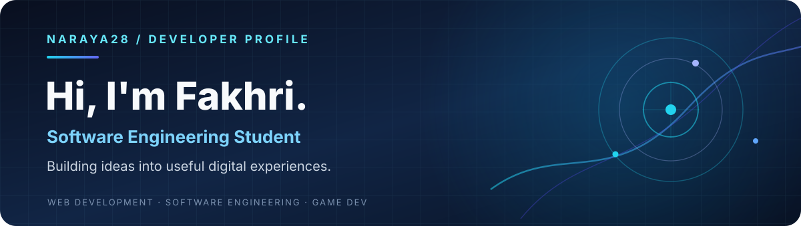
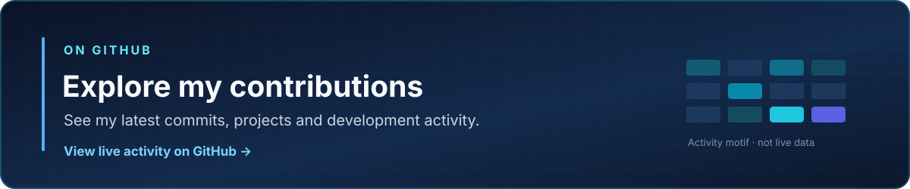

  

  
<strong>Software Engineering Student · Web Developer · Exploring Game Development</strong>

  
Building practical software, learning with purpose, and turning ideas into working projects.

  

---

### 👨‍💻 About Me

Hi, I'm **Fakhri**, a software engineering student interested in building practical digital experiences and understanding the systems behind them.

- 💻 **Interests:** Software Engineering, Web Development, and Data Analysis.
- 🧩 **What I build:** Web applications, software projects, and interactive experiments.
- 🎮 **Currently exploring:** Game Development with JavaScript and Phaser.
- 🌱 **Approach:** Learn by building, testing, documenting, and improving.

### 🛠️ Tech Stack & Tools

**Web & Programming**

  

**Database & Developer Tools**

  

Technologies I've used or am learning; this list doesn't imply advanced proficiency in every tool.

### 🚀 Featured Projects

<table>
  <tr>
    <td width="50%" valign="top">
      <h3>🎮 Neon Protocol: Rift</h3>
      
A 2D browser game learning project built with Phaser, JavaScript, and Vite. The game is being developed in stages.

      
<strong>Stack:</strong> JavaScript · Phaser · Vite

      
<a href="https://github.com/Naraya28/neon-protocol-rift"><strong>View source code →</strong></a>

    </td>
    <td width="50%" valign="top">
      <h3>🕌 Sistem Informasi Masjid</h3>
      
A PHP-based mosque information website featuring news, information pages, and management sections.

      
<strong>Stack:</strong> PHP · HTML · CSS · JavaScript

      
<a href="https://github.com/Naraya28/sistem-informasi-masjid"><strong>View source code →</strong></a>

    </td>
  </tr>
</table>

### 📈 GitHub Activity

  
  
Click the card to explore activity on GitHub. The graphic is decorative and does not display live statistics.

### 🎯 Current Focus

- Strengthening my foundations in full-stack web development and software engineering.
- Improving code quality, project documentation, and system architecture.
- Exploring game development and data-oriented problem solving.

---

  <strong>Code. Learn. Build. Repeat.</strong>
  
Thanks for visiting — take a look at my work and follow my development journey.

  <a href="https://github.com/Naraya28?tab=repositories">Browse my repositories</a>

